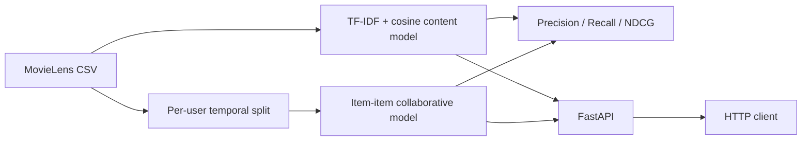

# TasteMatch — Movie Recommendation System

A reproducible recommendation-system project using the **MovieLens latest-small** public dataset. It implements content-based and item-item collaborative filtering, a per-user temporal holdout, ranking metrics, an analysis notebook and a FastAPI service.

## Dataset
- GroupLens MovieLens latest-small: https://grouplens.org/datasets/movielens/latest/
- Direct archive: https://files.grouplens.org/datasets/movielens/ml-latest-small.zip
- Files used: `ratings.csv` and `movies.csv`.
- Dataset is downloaded on demand and is not committed. Respect the GroupLens dataset terms and cite GroupLens when presenting results.

## Problem and methods
Given movie metadata or a user's rating history, produce a ranked list of movies the user has not rated.
- **Content-based:** TF-IDF vectorization of genre tokens and cosine similarity between movies.
- **Collaborative:** item-item cosine similarity over a user-item rating matrix; recommend high-scoring unseen movies.
- **Evaluation:** each user's latest timestamped ratings are held out. Ratings >= 4 are treated as relevant. Report macro-averaged Precision@K, Recall@K and NDCG@K. The threshold and temporal split are explicit design choices, not universal truths.

## Architecture


## Tech stack
Python 3.11+, pandas, NumPy, scikit-learn, SciPy, FastAPI, pytest, Jupyter, Docker.

## Setup and run
```bash
python -m venv .venv
# macOS/Linux: source .venv/bin/activate
# Windows PowerShell: .venv\\Scripts\\Activate.ps1
python -m pip install -r requirements.txt
```
Download data and inspect:
```bash
PYTHONPATH=src python -c "from tastematch.data import load_movielens; r,m=load_movielens(); print(r.shape,m.shape)"
```
Run analysis:
```bash
PYTHONPATH=src python notebooks/analysis.py
```
Run API:
```bash
PYTHONPATH=src uvicorn tastematch.api:app --reload --port 8001
```
Or run with Docker:
```bash
docker compose up --build
```
API docs: http://localhost:8001/docs. Health: http://localhost:8001/health. Example endpoints: `/recommend/content?movie_id=1&k=10` and `/recommend/collaborative?user_id=1&k=10`.

## Tests
```bash
ruff check src tests
PYTHONPATH=src pytest -q
```
Unit tests use small synthetic data and do not download MovieLens. Full evaluation requires network access on first run.

## Results
No benchmark numbers are hard-coded in this repository. Execute the notebook or `notebooks/analysis.py` to produce dataset shapes and ranking metrics in your environment. Record the output, package versions, split policy and K value before quoting results on a CV. The included unit tests verify metric calculations on synthetic examples, not model quality on MovieLens.

## Limitations
- Genre-only content features are sparse and do not capture plot, cast or semantic similarity.
- Item-item similarity uses explicit ratings and a dense item similarity matrix; scale and memory usage become problematic for large catalogs.
- New users have no collaborative recommendations until they rate items.
- Temporal holdout can still have item cold-start cases; unseen train items are not recommended by the current model.
- This is an educational baseline, not a production recommender with online feedback or ranking experimentation.

## Decisions and assumptions
- MovieLens latest-small is selected because it is public, compact and easy for reviewers to reproduce.
- A user's latest 20% of interactions (at least one, while retaining one training interaction) are held out.
- A rating threshold of 4.0 defines relevance.
- API model loading is cached in-process; first request downloads and fits models, so it can be slow.

## What I would improve
- Add title/overview/tag features, hybrid ranking and popularity fallback.
- Use sparse top-neighbor computation and approximate nearest neighbors for scale.
- Add user-based baselines, MAP@K, coverage, novelty and confidence intervals.
- Add model artifact versioning, data checksums and a scheduled retraining pipeline.
- Add API authentication, request limits, structured logs and latency monitoring.
